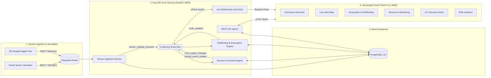

# PyroNav — Autonomous, Cyber-Defended Emergency Egress & Predictive Fire Safety Infrastructure

[](https://www.python.org/)
[](https://fastapi.tiangolo.com/)
[](https://react.dev/)
[](https://vitejs.dev/)
[](https://www.postgresql.org/)
[](https://mosquitto.org/)

**PyroNav** is a real-time, cyber-defended life-safety infrastructure platform designed to monitor building fire sensors, evaluate multi-tier hazard levels using OSHA/NFPA-aligned decision algorithms, isolate cyber-attacks and compromised IoT nodes, and dynamically compute safe emergency evacuation routes that steer occupants away from hazardous zones in real time over WebSockets.

> ⚠️ **Academic Prototype Notice:** The demonstration hospital building model and sensor dataset located in `shared-contracts/mock-data` represent illustrative prototype scenarios for academic validation and research, not a certified life-safety installation.

---

## 🏛️ System Architecture



---

## 🚀 Key Capabilities & Modules

### 1. Command Overview (Dashboard)
- **Dynamic Hero Card**: Real-time severity banner (`NORMAL`, `WARNING`, `HIGH_RISK`, `CRITICAL`) with live diagnostic explanations and one-click navigation to active evacuation routes.
- **2×2 KPI Status Grid**: Instant metrics for Rooms at Risk, Online Sensors ratio, Untrusted Sensors count, and Building Average Risk Score.
- **Side-by-Side Live Map View**:
  - **Live Heatmap**: Real-time room hazard gradients with an interactive risk level breakdown legend.
  - **Evacuation Routes**: Active emergency paths showing exit destination (`→ EXIT-01`), path cost in meters, algorithm badge (`dijkstra`), or fallback route calculation prompts.
- **Sensor Coverage Bar**: Visual status bar tracking online, stale, and offline field devices.

### 2. Live Heat Map (`/map`)
- Full 2D architectural blueprint view with color-coded thermal and smoke danger zones.
- **Filter Bar**: Layer toggles for Fire, Sensors, Blocked paths, and IDS security alerts.
- **Sensor Health Dots**: Visual indicators distinguishing operational devices (green) from failed devices (red pulsing).
- **Room Analysis Panel**: Click-to-inspect drawer displaying real-time sensor readings (temperature `°C`, smoke level, electrical current `A`, CO `ppm`), data quality, and update timestamps.

### 3. Evacuation & Pathfinding (`/evacuation`)
- **Multi-Algorithm Engine**: Evaluates and compares evacuation routes using **Dijkstra's Algorithm**, **A\***, and **Breadth-First Search (BFS)**.
- **Hazard-Aware Dynamic Rerouting**: Excludes blocked corridors, flashover zones, and critical rooms with hysteresis buffers.
- **Turn-by-Turn Waypoints**: Step-by-step egress guidance from any room to the safest exterior building exit.

### 4. Sensors & Monitoring (`/sensors`)
- Comprehensive telemetry registry displaying unit configurations, signal freshness timers, status badges (`ACTIVE`, `STALE`, `OFFLINE`, `ERROR`), and real-time WebSocket feeds.

### 5. IoT Security Centre (`/security`)
- Intrusion Detection System (IDS) telemetry auditing sensor integrity.
- Detects spoofed readings, compromised sensors, and malicious packets, tagging untrusted nodes to prevent falsified fire reports from corrupting evacuation paths.

### 6. Risk Analytics & Simulation (`/risk`, `/simulation`)
- Quantitative hazard formulas evaluating temperature rate of rise, smoke obscuration, and electrical load against OSHA/NFPA-derived safety thresholds.
- Controlled test harness to inject fire scenarios and simulate sensor disconnects.

### 7. 3D Digital Twin (`hospital-3d`)
- Interactive WebGL/Three.js 3D building model with spatial room navigation, sensor sliders, and direct MQTT telemetry broadcast.

---

## 🛠️ Quick Start Guide

### Prerequisites
- **Python:** 3.11 – 3.14
- **Node.js:** 18+ (LTS recommended)
- **PostgreSQL:** 13+ (or Docker)
- **Mosquitto MQTT:** Optional for standalone local development; included in Docker Compose

---

### Option A — Docker Compose (Full Stack in One Command)

Starts PostgreSQL, Mosquitto MQTT, and the FastAPI backend automatically:

```bash
docker compose up -d --build
```

- **API Documentation (Swagger UI):** http://localhost:8000/docs
- **Health Check:** http://localhost:8000/api/v1/health

To start the frontend dashboard alongside Docker:
```bash
cd frontend
npm install
npm run dev
```
Open http://localhost:3000 in your browser.

---

### Option B — Local Development (Windows PowerShell)

#### 1. Database Setup
```powershell
# Start PostgreSQL container…
docker compose up -d db

# …or load setup SQL into native PostgreSQL:
psql -U postgres -f backend\database\setup_database.sql
```

#### 2. Backend Setup
```powershell
cd backend
py -3.14 -m venv venv                                 # Any Python 3.11-3.14
.\venv\Scripts\python.exe -m pip install -r requirements.txt
copy .env.example .env                                # Verify database credentials
.\venv\Scripts\python.exe -m database.migrations.migrate
.\venv\Scripts\python.exe -m database.seed --replace  # Populates demo hospital building
```

#### 3. Frontend Setup
```powershell
cd ..\frontend
npm.cmd install
```

#### 4. Run Development Servers (Two Terminals)

**Terminal 1 — Backend:**
```powershell
cd backend
.\venv\Scripts\python.exe -m uvicorn api.main:app --reload --port 8000
```

**Terminal 2 — Frontend Dashboard:**
```powershell
cd frontend
npm.cmd run dev
```
Access the dashboard at **http://localhost:3000**.

> **Note on Standalone Mode:** The backend can run even without a running PostgreSQL database. When DB connection fails, reads automatically fallback to `shared-contracts/mock-data` with `demo_data: true`, keeping UI development fully functional.

---

### Option C — 3D Digital Twin (`hospital-3d`)

```powershell
cd hospital-3d
npm.cmd install
npm.cmd run dev
```
Runs at **http://localhost:5173** (or the designated port) to interact with 3D floor models and inject real-time MQTT telemetry.

---

## 📡 Live Sensor Data Flow (MQTT → Event Bus → WebSocket)

```
3D Digital Twin / Simulator --(MQTT WS :9001)--> Mosquitto Broker --(MQTT TCP :1883)-->
   API Ingestion Service --> In-Memory Event Bus --> WebSocket /ws/v1/live --> React Dashboard
```

1. **Start MQTT Broker:** `docker compose up -d mosquitto` (or run local service).
2. **Ensure Background Ingestion is Active:** In `backend/.env`, set `BACKGROUND_SERVICES=sensor_ingestion.service`.
3. **Verify Connection:** `GET http://localhost:8000/api/v1/health` will return `"mqtt": "connected"` and `"service:mqtt_ingestion": "running"`.

---

## 📁 Repository Layout

```
PyroNav/
├── backend/
│   ├── api/                   # FastAPI routing, middleware, auth, config
│   │   └── routes/            # Building, rooms, sensors, routes, alerts, security
│   ├── database/              # PostgreSQL pool, migrations/, seed.py, schemas
│   ├── decision_engine/       # OSHA/NFPA hazard evaluator, room state manager, thresholds
│   ├── events/                # In-memory pub/sub event bus & event contracts
│   ├── monitoring/            # Health check registry, logging, metrics collectors
│   ├── mqtt/                  # Mosquitto configs and test harnesses
│   ├── pathfinding/           # Dijkstra, A*, BFS hazard-aware routing engines
│   ├── sensor_ingestion/      # MQTT subscriber and payload normalization
│   ├── utils/                 # JSON serialization, backoff retry utilities
│   ├── websocket/             # /ws/v1/live hub, connection manager, broadcaster
│   └── tests/                 # Unit & integration tests, Locust load tests
│
├── frontend/                  # React 18 + Vite Web Application
│   ├── src/
│   │   ├── components/        # BuildingMap2D, BuildingHeatmap, RoomAnalysisPanel, etc.
│   │   ├── contexts/          # ThemeContext (Light & Dark mode state)
│   │   ├── hooks/             # useWebSocket, real-time event listeners
│   │   ├── pages/             # Overview, LiveMap (Heat Map), Evacuation, Sensors, Security
│   │   ├── services/          # REST API client
│   │   └── styles/            # Neumorphic CSS design tokens & animations
│   └── vite.config.js         # Proxy configuration (:8000 API & WebSocket)
│
├── hospital-3d/               # 3D Digital Twin visualization app (Three.js/WebGL)
├── shared-contracts/          # OpenAPI specifications, WebSocket schema, mock building fixtures
├── docs/                      # Technical specifications, architecture, deployment, UI/UX guides
├── docker-compose.yml         # Container configuration for API, PostgreSQL, and Mosquitto
└── setup-windows.ps1          # Automated Windows setup assistant
```

---

## 📖 Key Documentation

| Document | Description |
| :--- | :--- |
| **[shared-contracts/api-endpoints.md](shared-contracts/api-endpoints.md)** | Comprehensive REST API endpoint reference and curl examples |
| **[shared-contracts/websocket-events.json](shared-contracts/websocket-events.json)** | WebSocket event schema, payload formats, and lifecycle events |
| **[docs/ARCHITECTURE.md](docs/ARCHITECTURE.md)** | Deep dive into component interaction, event flows, and database schema |
| **[docs/UI-UX-SPECIFICATION.md](docs/UI-UX-SPECIFICATION.md)** | Visual design system, neumorphic token rules, and theme specs |
| **[docs/DEPLOYMENT.md](docs/DEPLOYMENT.md)** | Production deployment, environment variable catalog, and backups |
| **[docs/TESTING.md](docs/TESTING.md)** | Test suite execution, load testing scenarios, and benchmarks |
| **[docs/DEMO_SCRIPT.md](docs/DEMO_SCRIPT.md)** | Step-by-step evaluation script for demonstration presentations |

---

## 👥 Project Team & Responsibility Distribution

| Member | Primary Focus Area | Key Deliverables |
| :--- | :--- | :--- |
| **Member 1** | 3D Digital Twin & Sensor Ingestion | `hospital-3d`, virtual sensor simulator, Mosquitto MQTT ingestion |
| **Member 2** | Heatmap, UI Design & Decision Engine | `BuildingHeatmap`, `RoomAnalysisPanel`, Hazard classification engine |
| **Member 3** | Pathfinding & Navigation Experience | `BuildingMap2D`, Dijkstra/A*/BFS engines, Theme system integration |
| **Member 4** | Backend Core & Data Architecture | Database migrations, FastAPI framework, WebSocket event hub |

---

## 📄 License & Attribution

This project is developed for academic research and demonstration under the PyroNav project initiative. See [docs/](docs/) for research citations and threshold justification documentation.
