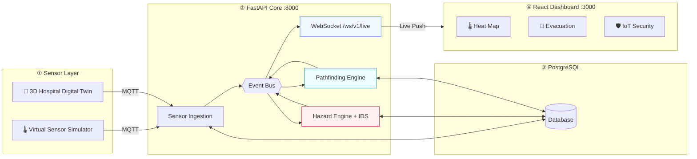

<!-- ═══════════════════════════════════════════════════════════════════════════ -->
<!--                        PYRONAV  —  README.md                              -->
<!-- ═══════════════════════════════════════════════════════════════════════════ -->

<div align="center">

<!-- ── HERO BANNER ──────────────────────────────────────────────────────────── -->


<!-- ── ANIMATED TYPEWRITER ───────────────────────────────────────────────────── -->


<!-- ── BADGE ROW ──────────────────────────────────────────────────────────────── -->
<br/>

[](https://www.python.org/)
[](https://fastapi.tiangolo.com/)
[](https://react.dev/)
[](https://vitejs.dev/)
[](https://www.postgresql.org/)
[](https://mosquitto.org/)
[](https://www.docker.com/)

<br/>

<!-- ── STATS BADGES ───────────────────────────────────────────────────────────── -->


</div>

---

<!-- ── QUICK-NAV ────────────────────────────────────────────────────────────────── -->
<div align="center">

### 🧭 Navigate

[Architecture](#-system-architecture) · [Pipeline](#-real-time-response-pipeline) · [Capabilities](#-key-capabilities--modules) · [Quick Start](#-quick-start-guide) · [Data Flow](#-live-sensor-data-flow) · [Repository](#-repository-layout) · [Team](#-project-team)

</div>

---

<!-- ── TECH STACK ICONS ───────────────────────────────────────────────────────── -->
## 🧰 Technology Stack

<div align="center">

</div>

<br/>

> **PyroNav** is a real-time, cyber-defended life-safety infrastructure platform that monitors building fire sensors, evaluates multi-tier hazard levels using OSHA/NFPA-aligned decision algorithms, isolates cyber-attacks and compromised IoT nodes, and dynamically computes safe emergency evacuation routes — streamed live to the dashboard over WebSockets.
>
> ⚠️ **Academic Prototype:** The demonstration hospital model and sensor data in `shared-contracts/mock-data` are for academic validation only, not a certified life-safety installation.

---

<!-- ══════════════════════════════════════════════════════════════════════════════ -->
<!--  SYSTEM ARCHITECTURE DIAGRAM  (HTML table — renders on GitHub)               -->
<!-- ══════════════════════════════════════════════════════════════════════════════ -->
## 🏛️ System Architecture

<div align="center">

```
┌─────────────────────────────────────────────────────────────────────────────────┐
│                    PYRONAV · SYSTEM ARCHITECTURE                                │
│          Telemetry ingestion · Decision intelligence · Live interface           │
└─────────────────────────────────────────────────────────────────────────────────┘
```

</div>

<table align="center" width="98%">
<tr>
<td align="center" width="20%" style="border:2px solid #F97316; border-radius:12px; padding:16px; background:#fff7ed;">

**01 / INPUTS**

🌡️ Virtual Sensor Simulator
🏥 3D Hospital Digital Twin

</td>
<td align="center" width="4%">──MQTT──►</td>
<td align="center" width="18%" style="border:2px solid #0891B2; border-radius:12px; padding:16px; background:#ecfeff;">

**02 / TRANSPORT**

📡 Mosquitto
MQTT Broker

</td>
<td align="center" width="4%">─Telemetry─►</td>
<td align="center" width="30%" style="border:2px solid #E11D48; border-radius:12px; padding:16px; background:#fff1f2;">

**03 / FASTAPI CORE**

⚙️ Sensor Ingestion Service
🧠 Event Bus + Hazard Engine
🛡️ IoT Intrusion Detection
🧭 Dijkstra · A\* · BFS
🔌 REST API + Live WebSocket

</td>
<td align="center" width="4%">◄─DB─►</td>
<td align="center" width="14%" style="border:2px solid #0891B2; border-radius:12px; padding:16px; background:#ecfeff;">

**04 / DATA**

🗄️ PostgreSQL
Persistent records

</td>
</tr>
<tr><td colspan="7" align="center">↕ HTTP / WS</td></tr>
<tr>
<td colspan="5"></td>
<td colspan="2" align="center" style="border:2px solid #7C3AED; border-radius:12px; padding:16px; background:#f5f3ff;">

**05 / EXPERIENCE**

⚛️ React Dashboard
Heatmap · Routes · Alerts

</td>
</tr>
</table>

<div align="center">
<sub><i>Conceptual component view · Refer to <a href="docs/ARCHITECTURE.md">docs/ARCHITECTURE.md</a> for implementation details</i></sub>
</div>

<br/>



---

<!-- ══════════════════════════════════════════════════════════════════════════════ -->
<!--  REAL-TIME PIPELINE                                                           -->
<!-- ══════════════════════════════════════════════════════════════════════════════ -->
## ⚡ Real-Time Response Pipeline

<div align="center">

```
╔═══════════════════════════════════════════════════════════════════════════════════╗
║              PYRONAV / REAL-TIME RESPONSE PIPELINE                               ║
╚═══════════════════════════════════════════════════════════════════════════════════╝
```

</div>

<table align="center" width="98%">
<tr>
<td align="center" width="18%" style="border:2px solid #F97316; border-radius:12px; padding:14px;">

🟠 **01 / SENSE**
Sensors + 3D Twin

</td>
<td align="center">──►</td>
<td align="center" width="18%" style="border:2px solid #0891B2; border-radius:12px; padding:14px;">

🔵 **02 / STREAM**
MQTT Broker

</td>
<td align="center">──►</td>
<td align="center" width="18%" style="border:2px solid #E11D48; border-radius:12px; padding:14px;">

🔴 **03 / ASSESS**
Hazard + IDS

</td>
<td align="center">──►</td>
<td align="center" width="18%" style="border:2px solid #0891B2; border-radius:12px; padding:14px;">

🔵 **04 / REROUTE**
Safe Pathfinding

</td>
<td align="center">──►</td>
<td align="center" width="18%" style="border:2px solid #7C3AED; border-radius:12px; padding:14px;">

🟣 **05 / ALERT**
Live Dashboard

</td>
</tr>
</table>

<div align="center">
<sub><code>SENSE → STREAM → ASSESS → SECURE → REROUTE → ALERT</code></sub>
</div>

---

<!-- ══════════════════════════════════════════════════════════════════════════════ -->
<!--  KEY CAPABILITIES                                                             -->
<!-- ══════════════════════════════════════════════════════════════════════════════ -->
## 🚀 Key Capabilities & Modules

<table width="100%">
<tr>
<td width="50%" valign="top">

### 🖥️ 1. Command Overview
- **Dynamic Hero Card** — live severity banner (`NORMAL` → `CRITICAL`) with one-click evacuation navigation
- **2×2 KPI Grid** — Rooms at Risk, Sensors Online ratio, Untrusted Sensors, Avg Risk Score
- **Side-by-Side Map View** — Live heatmap + active evacuation route panel

### 🌡️ 2. Live Heat Map `/map`
- Full 2D architectural blueprint with color-coded hazard gradients
- Layer toggles: Fire · Sensors · Blocked Paths · IDS Alerts
- **Room Analysis Panel** — click-to-inspect sensor readings (temp `°C`, smoke `ppm`, current `A`, CO `ppm`)

### 🧭 3. Evacuation & Pathfinding `/evacuation`
- Multi-algorithm engine: **Dijkstra · A\* · BFS** side-by-side comparison
- Hazard-aware dynamic rerouting with hysteresis buffers
- Turn-by-turn waypoint guidance to the safest exit

</td>
<td width="50%" valign="top">

### 📡 4. Sensors & Monitoring `/sensors`
- Telemetry registry with signal freshness timers
- Status badges: `ACTIVE` · `STALE` · `OFFLINE` · `ERROR`
- Real-time WebSocket feeds

### 🛡️ 5. IoT Security Centre `/security`
- IDS auditing sensor integrity in real time
- Detects spoofed readings, compromised sensors, malicious packets
- Tags untrusted nodes to prevent falsified fire data corrupting routes

### 📊 6. Risk Analytics & Simulation `/risk` `/simulation`
- Quantitative hazard formulas vs. OSHA/NFPA-derived thresholds
- Inject fire scenarios and simulate sensor disconnects

### 🏥 7. 3D Digital Twin `hospital-3d`
- WebGL/Three.js interactive building model
- Spatial room navigation + direct MQTT broadcast

</td>
</tr>
</table>

---

<!-- ══════════════════════════════════════════════════════════════════════════════ -->
<!--  QUICK START                                                                  -->
<!-- ══════════════════════════════════════════════════════════════════════════════ -->
## 🛠️ Quick Start Guide

### Prerequisites

| Tool | Version |
|:---|:---|
| Python | 3.11 – 3.14 |
| Node.js | 18+ LTS |
| PostgreSQL | 13+ (or Docker) |
| Mosquitto MQTT | optional — included in Docker Compose |

---

### 🐳 Option A — Docker Compose *(Full Stack, One Command)*

```bash
docker compose up -d --build
```

| Service | URL |
|:---|:---|
| 🔌 API + Swagger UI | http://localhost:8000/docs |
| ❤️ Health Check | http://localhost:8000/api/v1/health |

Then start the frontend:

```bash
cd frontend
npm install
npm run dev
# → http://localhost:3000
```

---

### 💻 Option B — Local Development (Windows PowerShell)

**1. Database**
```powershell
docker compose up -d db
# or: psql -U postgres -f backend\database\setup_database.sql
```

**2. Backend**
```powershell
cd backend
py -3.14 -m venv venv
.\venv\Scripts\python.exe -m pip install -r requirements.txt
copy .env.example .env
.\venv\Scripts\python.exe -m database.migrations.migrate
.\venv\Scripts\python.exe -m database.seed --replace
```

**3. Frontend**
```powershell
cd ..\frontend
npm.cmd install
```

**4. Run (two terminals)**

```powershell
# Terminal 1 — Backend
cd backend
.\venv\Scripts\python.exe -m uvicorn api.main:app --reload --port 8000

# Terminal 2 — Frontend
cd frontend
npm.cmd run dev
# → http://localhost:3000
```

> **Standalone Mode:** Backend runs without a DB — falls back to `shared-contracts/mock-data` with `demo_data: true`, keeping UI development fully functional.

---

### 🏥 Option C — 3D Digital Twin

```powershell
cd hospital-3d
npm.cmd install
npm.cmd run dev
# → http://localhost:5173
```

---

<!-- ══════════════════════════════════════════════════════════════════════════════ -->
<!--  LIVE DATA FLOW                                                               -->
<!-- ══════════════════════════════════════════════════════════════════════════════ -->
## 📡 Live Sensor Data Flow

```
┌──────────────────────┐     MQTT      ┌───────────────┐   Telemetry   ┌──────────────────────┐
│  3D Twin / Simulator │──── WS:9001 ──►  Mosquitto    │──── TCP:1883 ──►  API Ingestion       │
└──────────────────────┘               └───────────────┘               └──────────┬───────────┘
                                                                                   │
                                                                          In-Memory Event Bus
                                                                                   │
                                                                         ┌─────────▼──────────┐
                                                                         │  WebSocket         │
                                                                         │  /ws/v1/live       │
                                                                         └─────────┬──────────┘
                                                                                   │  Reactive Push
                                                                         ┌─────────▼──────────┐
                                                                         │  React Dashboard   │
                                                                         └────────────────────┘
```

1. **Start MQTT Broker:** `docker compose up -d mosquitto`
2. **Verify:** `GET http://localhost:8000/api/v1/health` → `"mqtt": "connected"`

---

<!-- ══════════════════════════════════════════════════════════════════════════════ -->
<!--  REPOSITORY LAYOUT                                                            -->
<!-- ══════════════════════════════════════════════════════════════════════════════ -->
## 📁 Repository Layout

```
PyroNav/
├── 🔧 backend/
│   ├── api/                   # FastAPI routing, middleware, auth, config
│   │   └── routes/            # buildings, rooms, sensors, routes, alerts, security
│   ├── database/              # PostgreSQL pool, migrations, seed, schemas
│   ├── decision_engine/       # OSHA/NFPA hazard evaluator, thresholds config
│   ├── events/                # In-memory pub/sub event bus & event contracts
│   ├── monitoring/            # Health registry, logging, metrics
│   ├── mqtt/                  # Mosquitto configs and test harnesses
│   ├── pathfinding/           # Dijkstra, A*, BFS hazard-aware routing
│   ├── sensor_ingestion/      # MQTT subscriber and payload normalizer
│   ├── websocket/             # /ws/v1/live hub, connection manager
│   └── tests/                 # Unit, integration & Locust load tests
│
├── ⚛️  frontend/
│   └── src/
│       ├── components/        # BuildingMap2D, BuildingHeatmap, RoomAnalysisPanel…
│       ├── hooks/             # useWebSocket, real-time event listeners
│       ├── pages/             # Overview, Heat Map, Evacuation, Sensors, Security
│       ├── services/          # REST API client
│       └── styles/            # Neumorphic CSS design tokens & animations
│
├── 🏥 hospital-3d/            # Three.js/WebGL 3D Digital Twin
├── 📋 shared-contracts/       # OpenAPI specs, WebSocket schema, mock building fixtures
├── 📖 docs/                   # Architecture, deployment, UI/UX, testing guides
├── 🐳 docker-compose.yml      # PostgreSQL + Mosquitto + FastAPI containers
└── ⚙️  setup-windows.ps1      # Automated Windows setup assistant
```

---

<!-- ══════════════════════════════════════════════════════════════════════════════ -->
<!--  DOCUMENTATION TABLE                                                          -->
<!-- ══════════════════════════════════════════════════════════════════════════════ -->
## 📖 Key Documentation

| Document | Description |
|:---|:---|
| [`shared-contracts/api-endpoints.md`](shared-contracts/api-endpoints.md) | REST API endpoint reference and curl examples |
| [`shared-contracts/websocket-events.json`](shared-contracts/websocket-events.json) | WebSocket event schema, payload formats, lifecycle |
| [`docs/ARCHITECTURE.md`](docs/ARCHITECTURE.md) | Component interaction, event flows, database schema |
| [`docs/UI-UX-SPECIFICATION.md`](docs/UI-UX-SPECIFICATION.md) | Neumorphic design system, CSS tokens, theme specs |
| [`docs/DEPLOYMENT.md`](docs/DEPLOYMENT.md) | Production deployment, env catalog, backups |
| [`docs/TESTING.md`](docs/TESTING.md) | Test suite execution, load testing, benchmarks |
| [`docs/DEMO_SCRIPT.md`](docs/DEMO_SCRIPT.md) | Step-by-step evaluation script for demo presentations |

---

<!-- ══════════════════════════════════════════════════════════════════════════════ -->
<!--  PROJECT TEAM                                                                 -->
<!-- ══════════════════════════════════════════════════════════════════════════════ -->
## 👥 Project Team

<table align="center" width="100%">
<tr>
<th align="center">Member</th>
<th align="center">Primary Focus</th>
<th align="center">Key Deliverables</th>
</tr>
<tr>
<td align="center">🟠 <b>Member 1</b></td>
<td>3D Digital Twin &amp; Sensor Ingestion</td>
<td><code>hospital-3d</code> · Virtual sensor simulator · Mosquitto MQTT ingestion</td>
</tr>
<tr>
<td align="center">🔴 <b>Member 2</b></td>
<td>Heatmap UI &amp; Decision Engine</td>
<td><code>BuildingHeatmap</code> · <code>RoomAnalysisPanel</code> · Hazard classification engine</td>
</tr>
<tr>
<td align="center">🔵 <b>Member 3</b></td>
<td>Pathfinding &amp; Navigation</td>
<td><code>BuildingMap2D</code> · Dijkstra / A* / BFS engines · Theme system</td>
</tr>
<tr>
<td align="center">🟣 <b>Member 4</b></td>
<td>Backend Core &amp; Data Architecture</td>
<td>Database migrations · FastAPI framework · WebSocket event hub</td>
</tr>
</table>

---

<!-- ══════════════════════════════════════════════════════════════════════════════ -->
<!--  HIGHLIGHTS                                                                   -->
<!-- ══════════════════════════════════════════════════════════════════════════════ -->
## 🌐 Project Highlights

<div align="center">

| | |
|:---:|:---|
| 🔴 | **Predictive hazard awareness** — multi-sensor threshold evaluation and room risk scoring |
| 🛡️ | **Cyber-aware monitoring** — flag suspicious or untrusted IoT readings before they corrupt routes |
| 🧭 | **Dynamic evacuation** — calculate routes around hazardous, blocked, or flashover zones |
| 📡 | **Live push updates** — changing system state streamed instantly to the dashboard |
| 🏥 | **Digital twin simulation** — test telemetry and fire scenarios in a virtual building |

</div>

---

<!-- ══════════════════════════════════════════════════════════════════════════════ -->
<!--  FOOTER                                                                       -->
<!-- ══════════════════════════════════════════════════════════════════════════════ -->


<div align="center">

**Built to explore safer, smarter, cyber-resilient emergency response.**

<sub>Academic prototype · Research and demonstration use · Not a certified life-safety system</sub>

<br/>


</div>
