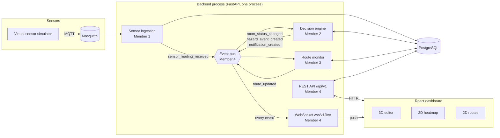
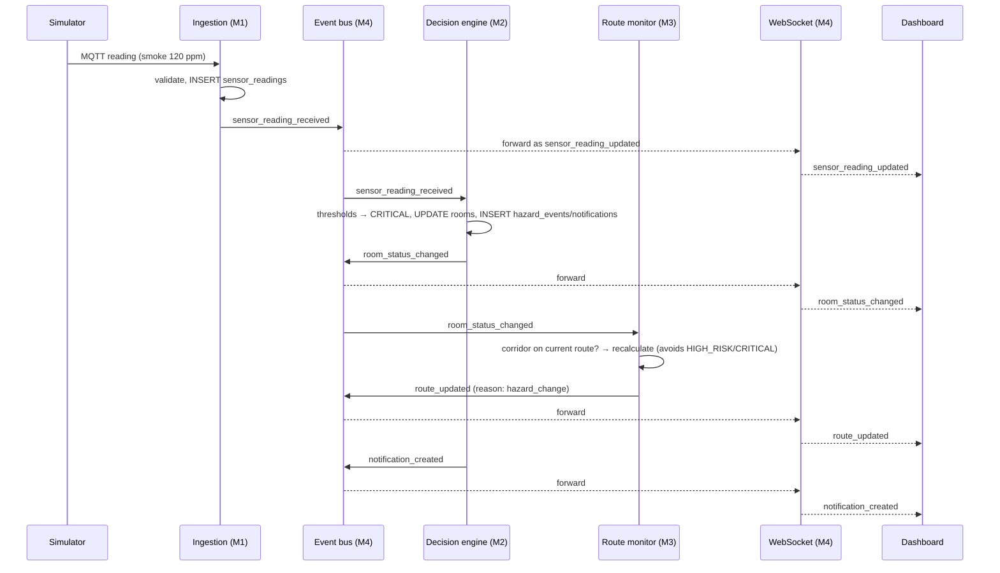
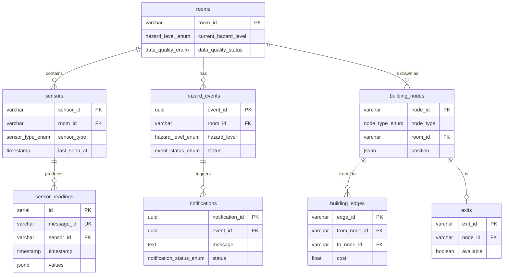

# PyroNav Architecture

## 1. System overview



| Component | Owner | Code |
| --- | --- | --- |
| MQTT ingestion, simulator, `sensors`/`sensor_readings` | Member 1 | `backend/sensor_ingestion/`, `backend/sensor_simulator/` |
| Decision engine, `rooms`/`hazard_events`/`notifications` | Member 2 | `backend/decision_engine/` |
| Pathfinding, `building_*`/`exits`/`route_results` | Member 3 | `backend/pathfinding/` |
| Database, API framework, event bus, WebSocket, monitoring, integration | Member 4 | `backend/api`, `database`, `events`, `websocket`, `monitoring`, `utils` |

## 2. Event flow — "smoke detected in the corridor"



This exact cascade is covered by `tests/test_integration.py` (simulated services) and by `tests/test_database_integration.py::test_route_recalculated_and_broadcast_when_hazard_blocks_path` (the real RouteMonitor and database).

**Delivery guarantees**
- Each client receives events in publish order.
- A client that can't receive within 5 s is disconnected and reconnects (the frontend hook retries after 3 s), so one frozen browser tab never delays everyone else.
- Payloads are serialised once per broadcast. `datetime`, `UUID` and `Decimal` values are safe to publish, and timestamps always carry `+00:00`.

## 3. Process model — why a single process

The event bus and the WebSocket connection list live **in memory**. So:

- **Run one API process** (`uvicorn api.main:app`, no `--workers N`). An event raised in worker A would never reach a browser connected to worker B. One async process easily handles a building's load: the Locust test ran at p95 22 ms (see [TESTING.md](TESTING.md)).
- **Teammates' long-running workers run inside the API process.** An MQTT subscriber started separately (`python sensor_ingestion/main.py`) has its own event bus, so the dashboard would never see its events. Register the worker instead (§5.3) and it shares the API's bus.

If PyroNav ever needs several processes, the extension point is `EventBus.publish_sync`: bridge it through PostgreSQL `LISTEN/NOTIFY` or Redis pub/sub. No caller would have to change.

## 4. Database

PostgreSQL 13+ (`gen_random_uuid()` is built in, so no extensions are needed). The schema is managed by numbered migrations in `backend/database/migrations/`.



Unrelated tables: `route_results`, `system_logs`, `api_audit_log`, `websocket_sessions`, `security_events`, `schema_migrations`.
Views: `latest_sensor_readings`, `active_hazards_by_room`, `room_sensor_freshness`.

**Design decisions**
- **All timestamps are UTC.** Pool sessions run with `timezone=UTC`, and migration 002 sets the database default. The API emits explicit `+00:00` offsets, because naive ISO strings are read as local time by JavaScript.
- **Hot-path indexes** (migration 002): `sensor_readings(sensor_id, timestamp DESC)` and `(room_id, timestamp DESC)` serve "latest reading per sensor/room" without a sort. They replace the single-column indexes from 001, which only added write cost.
- **Integrity**: `building_edges.cost >= 0`, because Dijkstra is only correct for non-negative weights.
- **Retention**: `purge_old_data(days)` deletes old readings, logs, audit rows and sessions. Hazard events and notifications are kept as incident history, and the latest route is always kept.

## 5. Integration guide for Members 1–3

### 5.1 Database access
```python
from database.connection import db_manager, DatabaseUnavailableError

rows = db_manager.fetch_all("SELECT * FROM rooms WHERE current_hazard_level = %s", ("CRITICAL",))  # list[dict]
row  = db_manager.fetch_one("INSERT INTO ... RETURNING event_id", (...))                           # dict | None
n    = db_manager.execute_write("UPDATE rooms SET ... WHERE room_id = %s", (room_id,))            # rowcount
with db_manager.get_connection() as conn:          # several statements, one transaction
    with conn.cursor() as cur: ...
```
- Pass dicts directly for JSONB columns (`{"smoke": 85}`); they are adapted automatically.
- Always use `%s` parameters, never f-strings with values.
- If PostgreSQL is down you get `DatabaseUnavailableError` (HTTP 503 from the API). The pool reconnects by itself once the database is back.

### 5.2 Publishing and subscribing to events
```python
from events.event_bus import event_bus, Event
from events import event_types as ev

event_bus.publish_sync(Event(ev.ROOM_STATUS_CHANGED, {
    "room_id": "operation_theater", "hazard_level": "CRITICAL", "previous_level": "WARNING",
}))
event_bus.subscribe(ev.SENSOR_READING_RECEIVED, handle_reading)   # sync or async handler
```
- `publish_sync` is safe from **any thread** (e.g. the paho-mqtt callback thread).
- Every event in `events/event_types.py` is forwarded to WebSocket clients automatically. Required fields are listed in `shared-contracts/websocket-events.json`, and extra fields are passed through.
- A handler that raises is logged (with traceback, in `system_logs`) and never breaks the other handlers.

| Member | Publishes | Subscribes to |
| --- | --- | --- |
| 1 | `sensor_reading_received`, `sensor_status_changed` | — |
| 2 | `room_status_changed`, `hazard_event_created`, `hazard_event_resolved`, `notification_created` | `sensor_reading_received` |
| 3 | `route_updated` (already done in `route_monitor.py`) | `room_status_changed` (already done) |

### 5.3 Running a background worker inside the API
```python
# backend/sensor_ingestion/service.py
from api.services import background_service

@background_service("mqtt_ingestion")
def start():
    subscriber = MqttSubscriber(...)
    subscriber.start()        # start your own thread — must not block
    return subscriber.stop    # optional; called on shutdown
```
Enable it in `backend/.env` with `BACKGROUND_SERVICES=sensor_ingestion.service,decision_engine.service`. Each service then appears in `GET /api/v1/health` as `service:<name>`.

### 5.4 Reporting health
```python
from monitoring.health import register_health_check
register_health_check("mqtt", lambda: {"status": "connected" if client.is_connected() else "disconnected",
                                       "last_message_at": last_seen})
```

### 5.5 Logging
```python
import logging
logger = logging.getLogger(__name__)
logger.warning("Sensor %s stale", sensor_id, extra={"metadata": {"sensor_id": sensor_id}})
```
Logs go to the console, `backend/logs/pyronav.log` (rotating, 10 MB × 5) and, from WARNING up, the `system_logs` table, which is queryable at `GET /api/v1/system/logs`. Prefer `logger` over `print()`.

## 6. Resilience

| Failure | Behaviour |
| --- | --- |
| PostgreSQL down at startup | The API still starts, and `/health` reports `degraded` |
| PostgreSQL down while running | Reads serve demo data (`demo_data: true`) when `DEMO_FALLBACK=true`, otherwise 503. Writes return 503 with `Retry-After` |
| PostgreSQL restarted | The dead pooled connections are discarded on first use and a new pool is created automatically (`test_pool_recovers_after_connection_loss`) |
| Audit or log writes while the DB is down | Queued on a background thread and dropped with a counter (`/system/stats` → `background_writer`). Requests are never slowed or failed by them |
| Slow or frozen WebSocket client | Dropped after 5 s, so the other clients are unaffected |
| A teammate's event handler crashes | Logged with traceback, and the other handlers still run |
| A background service fails to start | Reported in `/health`, and the API keeps running |

## 7. Request pipeline

`CORS → RequestContextMiddleware (request id, timing, metrics, audit) → router → handler`

- DB-backed handlers are plain `def` functions. FastAPI runs them in its thread pool, so blocking psycopg2 calls never stall the event loop or the WebSocket clients.
- `X-Request-ID` is returned on every response, included in error bodies, and stored in `api_audit_log`.
