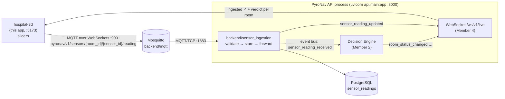

# PyroNav — 3D Hospital (sensor input module)

An interactive 3D model of the hospital ground floor (React + React Three Fiber + Three.js). Every room, corridor, hall and stairwell has a unique `room_id`; every sensor has a unique `sensor_id` tied to exactly one room. Each sensor has sliders. Moving a slider publishes the reading over **MQTT (Mosquitto)** in the team's agreed format, and the reading reaches **Member 2's Decision Engine** through the existing backend event bus. The engine's verdict comes back to the 3D view live, as a coloured room glow.

> Academic prototype. Sensor thresholds used for colouring are indicative only; the Decision Engine decides.

---

## 1. How it fits into PyroNav



* **Contract** (agreed in `docs/MEMBER-1-TASKS.md`, now formalised): topic `pyronav/v1/sensors/{room_id}/{sensor_id}/reading`, JSON payload with `message_id`, `sensor_id`, `room_id`, `sensor_type`, `timestamp`, `values`, `units` (+ `source`, `trigger`, `schema_version`, `building_id`, `floor_id`). Full spec: [`shared-contracts/sensor-message-schema.json`](../shared-contracts/sensor-message-schema.json).
* **Decision Engine delivery** follows `docs/ARCHITECTURE.md` §3/§5: ingestion runs **inside** the API process (`@background_service`) and publishes `sensor_reading_received` on the in-process event bus. The Decision Engine subscribes to it with `event_bus.subscribe(ev.SENSOR_READING_RECEIVED, handler)`. The reading is stored in `sensor_readings` before the event is published, so an engine that queries `latest_sensor_readings` also sees it.
* If Member 2's engine subscribes to MQTT directly instead (an option in `docs/MEMBER-2-TASKS.md`), it receives the same topic and payload. Nothing changes on this side.
* **Feedback loop:** the app listens on `/ws/v1/live`. `sensor_reading_updated` with our `message_id` marks a reading **ingested ✓**. `room_status_changed` colours the room with the engine's level.

## 2. What was added (and what was not touched)

All files are **new**. No existing file of any team member was modified.

```
PyroNav/
├── hospital-3d/                         NEW  standalone 3D app (frontend)
│   ├── package.json, vite.config.js, index.html, .env.example, .gitignore, README.md
│   └── src/
│       ├── App.jsx, main.jsx, config.js, styles.css
│       ├── data/
│       │   ├── hospitalLayout.js        floor plan (rooms, doors, exits) traced from the reference image
│       │   ├── sensorRegistry.js        sensors + 3D positions from shared-contracts/hospital-3d-sensors.json
│       │   └── sensorTypes.js           slider ranges + indicative colour bands
│       ├── mqtt/
│       │   ├── mqttClient.js            mqtt.js over WebSockets (QoS 1, reconnect, last will)
│       │   ├── messageBuilder.js        builds the contract payload and topic
│       │   └── publisher.js             slider throttling, periodic reporting, delivery tracking
│       ├── hooks/useDecisionFeed.js     WebSocket /ws/v1/live + GET /api/v1/rooms
│       ├── state/useSimStore.js         zustand store
│       ├── scene/                       3D model
│       │   ├── HospitalScene.jsx        canvas, lights, camera, controls
│       │   ├── Building.jsx             floors, generated walls, doors, labels, hazard glow
│       │   ├── RoomFurniture.jsx        per-room furniture and equipment
│       │   ├── Exterior.jsx             site, entrance, ambulance bay, exit signs
│       │   ├── furniture/               clinical.jsx, specialist.jsx, general.jsx, safety.jsx
│       │   └── sensors/                 SensorDevices.jsx (3D sensors), HazardEffects.jsx (smoke/fire)
│       └── ui/                          TopBar, ViewControls, ControlPanel, SensorsTab, SensorCard,
│                                        MessagesTab, SettingsTab, exportBuilding.js
├── backend/
│   ├── mqtt/                            NEW  Mosquitto config + CLI tools (planned in MEMBER-1-TASKS.md)
│   │   ├── mosquitto.conf               listeners 1883 (TCP) + 9001 (WebSockets)
│   │   ├── docker-compose.yml           eclipse-mosquitto:2.0.18 container
│   │   ├── test_publisher.py            publish a reading from the CLI
│   │   ├── test_subscriber.py           watch + validate readings on the broker
│   │   └── README.md
│   ├── sensor_ingestion/                NEW  MQTT → validate → PostgreSQL → event bus (Member 1 backend)
│   │   ├── service.py                   @background_service("mqtt_ingestion") + health check "mqtt"
│   │   ├── mqtt_subscriber.py           paho-mqtt 2.x client, reconnect, worker thread
│   │   ├── pipeline.py                  validate → store → publish sensor_reading_received
│   │   ├── message_validator.py         contract validation (pydantic)
│   │   ├── database_writer.py           sensor_readings insert, sensors.last_seen_at
│   │   ├── registry.py                  registers 3D rooms/sensors in the DB (CLI)
│   │   ├── config.py, requirements.txt, README.md
│   └── tests/test_sensor_ingestion.py   NEW  26 tests (contract, validation, pipeline, event bus, DB)
└── shared-contracts/
    ├── sensor-message-schema.json       NEW  MQTT topic + payload contract (JSON Schema)
    └── hospital-3d-sensors.json         NEW  26 rooms / 57 sensors registry (single source of truth)
```

**Not modified:** `frontend/`, `backend/api`, `database`, `events`, `websocket`, `monitoring`, `pathfinding`, `requirements.txt`, `docker-compose.yml`, `shared-contracts/mock-data/*`, migrations. The 20 sensors and 16 rooms of `sample-sensors.json` / `sample-building.json` are reused **with identical ids, rooms and types**. A test enforces this.

## 3. Rooms and sensors

Sensor types use only the agreed enum (`hazard-levels.json` → `sensor_type`), so every reading is valid for the database and the Decision Engine:

| `sensor_type` | Device in the model | `values` sent |
| --- | --- | --- |
| `smoke_heat` | multi-criteria smoke + heat detector on the ceiling | `smoke` (ppm), `temperature` (degC) |
| `co` | carbon-monoxide detector on the wall at 1.5 m | `co` (ppm) |
| `current` | current transformer on a sub-distribution board | `current` (A), slider range 0–2 × rated current |

How sensors were chosen: smoke/heat detectors cover every space (≈ 9 m spacing, so large rooms and long corridors get several). CO detectors go where combustion gases appear: gas cooking, lab burners, ambulance and drop-off exhaust, and smouldering near ICU life support. Current monitors go on high-load or critical circuits: life support, OT electrosurgery, X-ray generator, lab appliances, medicine and blood refrigerators, infant warmers, the IT cabinet, the kitchen and the isolation-room exhaust fan. Each room's reasoning is in `sensor_rationale` in the registry and in the app.

**26 rooms, 57 sensors** (*new* = corridors, halls and stairwells added by this module):

| room_id | Room | Sensors (sensor_id · type · purpose) |
| --- | --- | --- |
| `icu` | ICU (4 Beds) | `SMOKE-ICU-01` · smoke_heat · Beds 1-2 (west bays)<br>`SMOKE-ICU-02` · smoke_heat · Beds 3-4 (east bays)<br>`CO-ICU-01` · co · Smouldering fire near life-support equipment<br>`CUR-ICU-01` · current · Life-support circuit (ventilators, monitors, pumps) |
| `isolation_room` | Isolation Room | `SMOKE-ISO-01` · smoke_heat · Isolation bed area<br>`CUR-ISO-01` · current · Negative-pressure exhaust fan / HEPA unit motor |
| `patient_room` | Patient Room (2 Beds) | `SMOKE-PAT-01` · smoke_heat · Two-bed patient room |
| `operation_theater` | Operating Theatre (OT) | `SMOKE-OT-01` · smoke_heat · Anaesthesia / head end of the table<br>`SMOKE-OT-02` · smoke_heat · Instrument / scrub side<br>`CUR-OT-01` · current · Electrosurgical unit and anaesthesia equipment circuit |
| `radiology` | Radiology (X-Ray) | `SMOKE-RAD-01` · smoke_heat · X-ray room<br>`CUR-RAD-01` · current · X-ray generator power feed |
| `lab` | Lab | `SMOKE-LAB-01` · smoke_heat · Laboratory benches<br>`CO-LAB-01` · co · Gas burners and fume hood<br>`CUR-LAB-01` · current · Incubators, centrifuges and lab refrigerators |
| `pharmacy` | Pharmacy | `SMOKE-PH-01` · smoke_heat · Dispensing counter<br>`SMOKE-PH-02` · smoke_heat · Medicine store shelving<br>`CUR-PH-01` · current · Medicine refrigerators (cold chain) |
| `waiting_area` | Waiting Area | `SMOKE-WA-01` · smoke_heat · Waiting hall, north half<br>`SMOKE-WA-02` · smoke_heat · Waiting hall, south half |
| `administration` | Administration | `SMOKE-ADM-01` · smoke_heat · Offices<br>`CUR-ADM-01` · current · IT / server cabinet and office equipment |
| `records` | Records | `SMOKE-REC-01` · smoke_heat · Paper archive |
| `general_ward` | General Ward (6 Beds) | `SMOKE-GW-01` · smoke_heat · Beds 1-2 and 4-5 (west half)<br>`SMOKE-GW-02` · smoke_heat · Beds 3 and 6 (east half) |
| `maternity_ward` | Maternity Ward (4 Beds) | `SMOKE-MAT-01` · smoke_heat · Beds 1-2 (west half)<br>`SMOKE-MAT-02` · smoke_heat · Beds 3-4 (east half)<br>`CUR-MAT-01` · current · Infant warmers and incubators (radiant heaters) |
| `cafeteria` | Cafeteria | `SMOKE-CAF-01` · smoke_heat · Dining area and kitchen line<br>`CO-CAF-01` · co · Gas cooking range<br>`CUR-CAF-01` · current · Kitchen appliances (fryers, ovens, warmers) |
| `main_lobby` | Main Lobby & Reception | `SMOKE-LOB-01` · smoke_heat · Lobby, west half<br>`SMOKE-LOB-02` · smoke_heat · Lobby, east half<br>`CO-LOB-01` · co · Main entrance drop-off (vehicle exhaust) |
| `emergency_dept` | Emergency Department | `SMOKE-ED-01` · smoke_heat · Treatment bays<br>`CO-ED-01` · co · Ambulance doors (idling vehicle exhaust) |
| `blood_bank` | Blood Bank | `SMOKE-BB-01` · smoke_heat · Blood storage room<br>`CUR-BB-01` · current · Blood refrigerators and plasma freezer |
| `corridor_north` *(new)* | North Corridor | `SMOKE-CRN-01` · smoke_heat · Outside ICU<br>`SMOKE-CRN-02` · smoke_heat · Outside Isolation Room<br>`SMOKE-CRN-03` · smoke_heat · Outside Patient Room<br>`SMOKE-CRN-04` · smoke_heat · Outside Operating Theatre<br>`SMOKE-CRN-05` · smoke_heat · Towards Exit NE |
| `corridor_west` *(new)* | West Corridor | `SMOKE-CRW-01` · smoke_heat · Outside Radiology<br>`SMOKE-CRW-02` · smoke_heat · Outside Lab |
| `corridor_east` *(new)* | East Corridor | `SMOKE-CRE-01` · smoke_heat · Outside General Ward<br>`SMOKE-CRE-02` · smoke_heat · Outside Maternity Ward |
| `corridor_south` *(new)* | South Corridor | `SMOKE-CRS-01` · smoke_heat · Outside Cafeteria<br>`SMOKE-CRS-02` · smoke_heat · Outside South-West Hall<br>`SMOKE-CRS-03` · smoke_heat · Lobby double doors<br>`SMOKE-CRS-04` · smoke_heat · Outside Emergency Department |
| `hall_southwest` *(new)* | South-West Hall | `SMOKE-HSW-01` · smoke_heat · Hall between Cafeteria and Lobby |
| `hall_southeast` *(new)* | South-East Hall | `SMOKE-HSE-01` · smoke_heat · Hall between ED and Blood Bank |
| `stair_nw` *(new)* | Stairwell NW (Exit NW) | `SMOKE-STNW-01` · smoke_heat · Stair core / Exit NW |
| `stair_ne` *(new)* | Stairwell NE (Exit NE) | `SMOKE-STNE-01` · smoke_heat · Stair core / Exit NE |
| `stair_sw` *(new)* | Stairwell SW (Exit SW) | `SMOKE-STSW-01` · smoke_heat · Stair core / Exit SW |
| `stair_se` *(new)* | Stairwell SE (Exit SE) | `SMOKE-STSE-01` · smoke_heat · Stair core / Exit SE |

## 4. Install

Prerequisites: Node.js 18+, Python 3.11–3.14 (the backend venv from the main README), PostgreSQL (or Docker), and Mosquitto 2.x (or Docker).

```bash
# 3D app
cd hospital-3d
npm install                                  # Windows PowerShell: npm.cmd install

# MQTT ingestion dependency (from backend/, inside the existing venv)
cd ../backend
pip install -r sensor_ingestion/requirements.txt   # Windows: .\venv\Scripts\python.exe -m pip install -r sensor_ingestion\requirements.txt
```

Mosquitto: install it natively (Windows installer from mosquitto.org, `apt install mosquitto`, `brew install mosquitto`) **or** use Docker. See [`backend/mqtt/README.md`](../backend/mqtt/README.md).

## 5. Configure

**Mosquitto:** use `backend/mqtt/mosquitto.conf` as is. It opens 1883 (TCP) and 9001 (WebSockets, needed by the browser), with anonymous access for development.

**Backend** (`backend/.env`, created from `.env.example`). The `MQTT_BROKER` and `MQTT_PORT` keys already exist; add the service:
```ini
MQTT_BROKER=localhost
MQTT_PORT=1883
BACKGROUND_SERVICES=sensor_ingestion.service
# together with Member 2's engine once it exists:
# BACKGROUND_SERVICES=sensor_ingestion.service,decision_engine.service
```
Optional keys (defaults shown): `MQTT_USERNAME`, `MQTT_PASSWORD`, `MQTT_TOPIC_READINGS=pyronav/v1/sensors/+/+/reading`, `MQTT_QOS=1`, `INGESTION_AUTO_REGISTER=true`, `INGESTION_MAX_AGE_SECONDS=300`, `INGESTION_STORE_INVALID=true`.

**3D app** (`hospital-3d/.env`, optional, from `.env.example`): `VITE_MQTT_URL=ws://localhost:9001`, `VITE_PERIODIC_SECONDS=15`, `PYRONAV_API_TARGET=http://localhost:8000`. Port 5173 is already in the API's default `CORS_ORIGINS`, and API calls go through the Vite proxy anyway.

## 6. Run (four terminals)

```bash
# 1. MQTT broker
mosquitto -c backend/mqtt/mosquitto.conf -v
#    or: docker compose -f backend/mqtt/docker-compose.yml up -d

# 2. Database (as in the main README), then the demo hospital
docker compose up -d db
cd backend && python -m database.migrations.migrate && python -m database.seed --replace

# 3. API with MQTT ingestion (BACKGROUND_SERVICES set in backend/.env)
cd backend && python -m uvicorn api.main:app --reload --port 8000

# 4. 3D hospital
cd hospital-3d && npm run dev            # → http://localhost:5173
```
Windows PowerShell: use `.\venv\Scripts\python.exe` for `python` and `npm.cmd` for `npm`, as in the main README.

On start the ingestion service registers the 10 extra rooms and all 57 sensors (`INGESTION_AUTO_REGISTER`). This is idempotent and never changes existing rooms. It also re-registers them automatically if someone runs `database.seed --replace`. To do it by hand: `python -m sensor_ingestion.registry` (or `--check` to only report).

## 7. Use

* **Select** a room or sensor by clicking it in 3D or in the *Sensors* tab. Search works on room or sensor ids.
* **Drag a slider.** Readings are published while you drag (at most every 250 ms per sensor) and once more when you release. You can also type an exact value. *Send* re-sends; ↺ resets to the baseline.
* **Delivery chain** under each sensor: `↑ sent → broker ✓ (QoS 1 PUBACK) → ingested ✓` (the backend stored it and forwarded it to the Decision Engine).
* **Decision Engine verdict:** the room glows amber, orange or red, and badges show the level (from `room_status_changed`).
* **Messages tab:** every published topic and payload, periodic batches, and Decision Engine events.
* **Settings:** broker URL, QoS, periodic reporting interval, *Publish all*, *Reset all*, and *Download building-config.json* (rooms, door connections, sensor positions and exits in metres, the Member 1 export format).
* **Periodic reporting** (default every 15 s): every sensor re-sends its current value, like real devices do, so the engine never marks data stale (60 s window). Set it to *Off* to test stale-data handling.
* **View:** Overview, Top (plan), Focus room, Cutaway walls, Labels, Effects (smoke, fire and sparks driven by the sliders), Legend.

## 8. Test

| Level | How | Expected |
| --- | --- | --- |
| Unit and contract | `cd backend && pytest tests/test_sensor_ingestion.py -v` | 26 passed (the DB test is skipped when PostgreSQL is down) |
| Whole backend | `cd backend && pytest` | Existing suite unchanged: 112 passed with PostgreSQL |
| Broker | `mosquitto_sub -h localhost -t 'pyronav/v1/sensors/#' -v`, then move a slider | JSON reading on `pyronav/v1/sensors/<room_id>/<sensor_id>/reading` |
| Contract check | `cd backend && python mqtt/test_subscriber.py` | Every message printed as `VALID` with its room and sensor |
| CLI publish | `python mqtt/test_publisher.py --sensor SMOKE-OT-01 --value smoke=120 --value temperature=70` | `acked=True`; the OT sensor appears in the app's log |
| Ingestion health | `GET http://localhost:8000/api/v1/health` | `components.mqtt.status = "connected"`, plus `received` / `forwarded` counters |
| Stored data | `GET /api/v1/sensors/SMOKE-OT-01/readings?limit=3` | The values you set, `validation_status: valid` |
| Decision Engine | Move OT smoke above 100 ppm | The engine's handler gets `sensor_reading_received` with `room_id=operation_theater`. Once it publishes `room_status_changed`, the OT glows |
| Live events | `python tests/test_websocket_client.py` (from `backend/`) | `sensor_reading_updated` events with `source: hospital-3d` |

A quick check for Member 2 that the engine receives the 3D readings, before the full engine is wired:
```python
# e.g. temporarily in decision_engine/service.py
from events.event_bus import event_bus
from events import event_types as ev
event_bus.subscribe(ev.SENSOR_READING_RECEIVED,
                    lambda e: print(e.data["room_id"], e.data["sensor_id"], e.data["sensor_type"], e.data["values"]))
```

## 9. Troubleshooting

| Symptom | Fix |
| --- | --- |
| Chip shows **MQTT Offline** | Mosquitto is not running, or the WebSocket listener is missing. Start it with `backend/mqtt/mosquitto.conf`; the browser needs port **9001**, not 1883 |
| `broker ✓` but never `ingested ✓` | The API is not running with `BACKGROUND_SERVICES=sensor_ingestion.service`, or `paho-mqtt` is missing. Check `/api/v1/health` → `service:mqtt_ingestion` / `mqtt` |
| *Decision feed Offline* | The API is not on :8000, or `PYRONAV_API_TARGET` is wrong. MQTT publishing still works |
| Ingestion log: `sensor … is not registered` | Run `python -m sensor_ingestion.registry` (needed after `database.seed --replace` when auto-register is off) |
| Rooms stay *Unknown* | Normal until Member 2's engine runs and writes `rooms.current_hazard_level` |
| Blank 3D view | WebGL is disabled in the browser. The sensor panel still works |

## 10. Notes for teammates (optional, not required to run)

* **Docker image:** to run ingestion inside the API container, add `paho-mqtt==2.1.0` to `backend/requirements.txt`, then set `BACKGROUND_SERVICES=sensor_ingestion.service` and `MQTT_BROKER=<broker host>` for the `api` service.
* **Docker build context:** adding `hospital-3d` to the root `.dockerignore` keeps `hospital-3d/node_modules` out of the build context, the same way `frontend` is excluded.
* **Dashboard link:** to open the 3D view from the dashboard sidebar, add an external link to `http://localhost:5173` in `frontend/src/components/SidebarNavigation.jsx`.
* **Corridor routing:** the corridor, hall and stair room ids exist in `rooms` and receive readings. Member 3 can add graph nodes for them to make routes corridor-aware.
